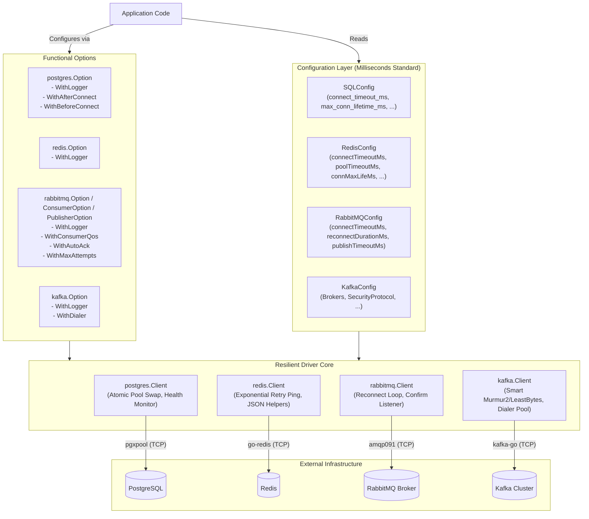
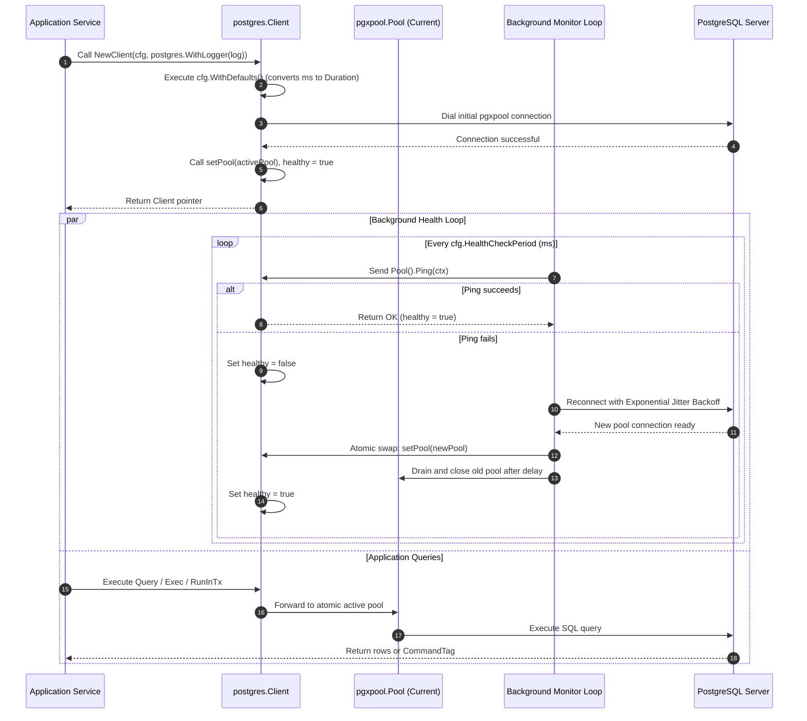
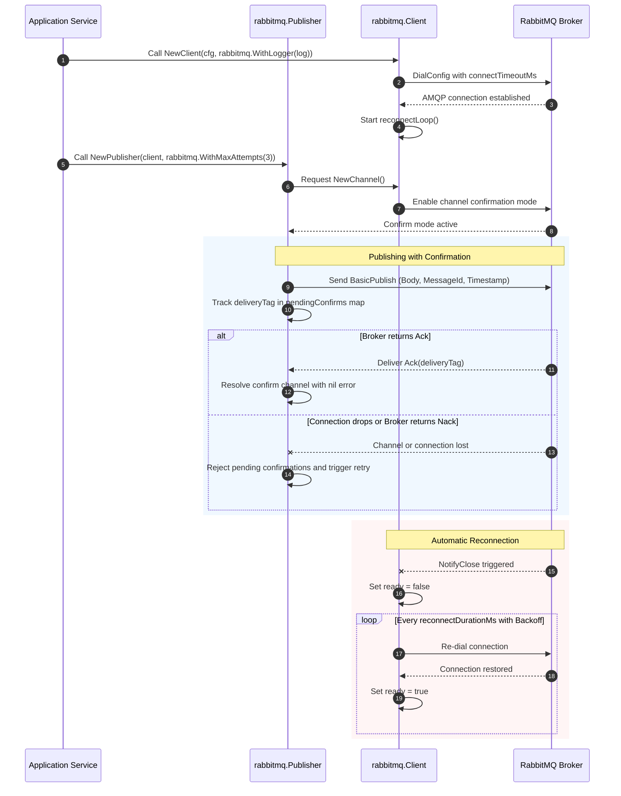

# Technical Documentation and Architecture Reference

## Overview
The `nvx-go-driver` library provides infrastructure client drivers for Go applications. It unifies connection pooling, reconnection resilience, distributed tracing, and configuration parameters for PostgreSQL, Redis, RabbitMQ, and Kafka.

---

## 1. System Architecture



---

## 2. PostgreSQL Connection Lifecycle and Pool Swapping



### Procedural Rules for Database Connections (ASD-STE100)
1. Initialize the PostgreSQL client using `postgres.NewClient`.
2. Access the active database pool through `client.Pool()`.
3. Wrap transactional operations with `client.RunInTx` for automatic rollback safety.
4. Close the client using `client.Close()` when the application shuts down.

---

## 3. RabbitMQ Reconnection and Publisher Confirm Sequence



---

## 4. Configuration Units Reference

All configuration durations use explicit milliseconds (`_ms` or `Ms`).

| Struct | Field Name | YAML/JSON Key | Default Value | Notes / Equivalent Duration |
| :--- | :--- | :--- | :--- | :--- |
| **`SQLConfig`** | `MaxConnLifetime` | `max_conn_lifetime_ms` | `3600000` | 1 hour |
| | `MaxConnIdleTime` | `max_conn_idle_time_ms` | `600000` | 10 minutes |
| | `HealthCheckPeriod` | `health_check_period_ms` | `15000` | 15 seconds |
| | `ConnectTimeout` | `connect_timeout_ms` | `10000` | 10 seconds |
| | `EnableTelemetry` | `enable_telemetry` | `false` | Enables OpenTelemetry SQL query spans |
| | `Schema` | `schema` | `"public"` | PostgreSQL `search_path` schema |
| **`RedisConfig`** | `StartInterval` | `startIntervalMs` | `2000` | 2 seconds |
| | `PoolTimeout` | `poolTimeoutMs` | `30000` | 30 seconds |
| | `ConnectTimeout` | `connectTimeoutMs` | `5000` | 5 seconds |
| | `ConnMaxLife` | `connMaxLifeMs` | `600000` | 10 minutes |
| **`RabbitMQConfig`**| `ReconnectDuration`| `reconnectDurationMs` | `5000` | 5 seconds |
| | `ConnectTimeout` | `connectTimeoutMs` | `10000` | 10 seconds |
| | `PublishTimeout` | `publishTimeoutMs` | `5000` | 5 seconds |

---

## 5. Functional Options Quick Reference

### 5.1 PostgreSQL Client Options
```go
client, err := postgres.NewClient(&cfg,
    postgres.WithLogger(logger),
    postgres.WithAfterConnect(func(ctx context.Context, conn *pgx.Conn) error {
        _, err := conn.Exec(ctx, "SET timezone = 'UTC'")
        return err
    }),
    postgres.WithBeforeConnect(func(ctx context.Context, connCfg *pgx.ConnConfig) error {
        connCfg.RuntimeParams["application_name"] = "custom-app"
        return nil
    }),
)
```

### 5.2 Redis Client Options
```go
client, err := redis.NewClient(&cfg,
    redis.WithLogger(logger),
)
```

### 5.3 RabbitMQ Options
```go
// 1. Client initialization
client, err := rabbitmq.NewClient(&cfg,
    rabbitmq.WithLogger(logger),
)

// 2. Consumer with functional options
consumer := rabbitmq.NewConsumer(client, "orders-queue",
    rabbitmq.WithConsumerQos(20),
    rabbitmq.WithAutoAck(false),
    rabbitmq.WithExclusive(false),
)

// 3. Publisher with retry options
publisher, err := rabbitmq.NewPublisher(client,
    rabbitmq.WithMaxAttempts(5),
)
```

### 5.4 Kafka Client Options
```go
client, err := kafka.NewClient(&cfg,
    kafka.WithLogger(logger),
    kafka.WithDialer(customDialer),
)
```
